# Options volatility surface modeling

> Turn noisy option quotes into an arbitrage-free surface, calibrate models to it, and study what implied vol pays.

**Status:** M1 to M5 done; M6 delivered except AC-H-01's day count and the timing runs (see [What is not done](#what-is-not-done)). Hourly Deribit recorder live since 2026-11-01 21:15 UTC. Every number below is read from a file under `results/`, which `uv run vsm reproduce --skip-ingest` regenerates; the file is named next to it.

| | |
|---|---|
| Track | Quant Researcher |
| Underlyings | Deribit BTC and ETH inverse options (crypto path only, D-03) |
| Stack | Python 3.12: NumPy, SciPy, Numba, Polars, Plotly |
| Data cost | USD 0: Deribit public API and free Tardis first-of-month files |
| History | 62 monthly snapshots (2020-03 to 2025-03, plus 2026-10) and 15 daily recorder snapshots (2026-11-02 to 2026-11-20) |

## Problem and hypothesis

Raw option quotes are noisy, stale and sometimes arbitrageable. A surface that is free of static arbitrage by construction is what every downstream use needs: a local vol model, a barrier price, a delta, or a variance swap rate. The project builds that surface every day for BTC and ETH and then asks two questions of it:

1. **What does a clean surface buy?** Compared with a cubic spline in implied vol, and compared with parametric models (Heston, SABR), how well does it fit, how stable is it, and does it stay arbitrage-free?
2. **Is there a variance risk premium in crypto after costs?** Does implied variance exceed realized variance, and does a delta-hedged short straddle earn it once fills, fees, slippage and funding are paid?

## Data

- **Recorder:** an hourly job at hh:15 UTC stores every BTC and ETH option and future quote from Deribit's public API (FR-01, FR-02). The 08:15 UTC snapshot is the canonical one for daily surfaces. Gaps are logged, never filled (`raw/deribit/_gaps.csv`).
- **History:** Deribit DVOL, perpetual hourly OHLC, funding and delivery prices, back to each series' start (FR-03).
- **Monthly backfill:** free Tardis.dev first-of-month `options_chain` files, streamed and cut to the 08:15 UTC snapshot (FR-04). 62 months, taken oldest first so the sample is not tilted towards quiet months (`docs/decisions.md`, M5). 2025-04 to 2026-09 are missing, by owner decision.
- **Conventions:** inverse options are priced in forward space in USD; the forward of each expiry comes from put-call parity on coin premiums (`docs/conventions.md`).
- **Recorder coverage, AC-W-04 not met.** Two host crashes, on 2026-11-11 and from 2026-11-12 to 2026-11-15, cost 84 hourly slots and 4 canonical days. Canonical days: 12 of 16 (75%, needs 90%). Hourly share over whole days with any snapshot: 88.7%; over only the hours the host was up: 99.3% (needs 95%). The owner ruled on 2026-11-17 to publish this as a documented miss with both readings (`results/metrics/recorder_coverage.json`, `docs/decisions.md`).
- **Licensing:** raw and row-level data stay out of git (`data/` is ignored). Only aggregates, metrics and figures are committed. Deribit data is attributed in the viewer.

## Method

The pipeline, per as-of snapshot (`docs/methods.md` has the detail):

1. **Clean** (FR-07): drop zero bids, crossed or stale quotes and wide markets, with a `drop_reason` on every dropped row.
2. **Forwards** (FR-08): Huber-weighted least squares on put-call parity per expiry, with the dated future and Deribit's `underlying_price` as fallbacks and cross-checks.
3. **Implied vol** (FR-09, FR-10): a safeguarded Householder iteration with a Brent fallback, in Numba, on the normalized Black-76 price.
4. **SSVI, then SVI slices** (FR-11, FR-12): a global SSVI surface first, which anchors the wings, then one raw SVI slice per expiry under butterfly (Durrleman's g > 0), Lee and calendar constraints.
5. **Arbitrage gate** (FR-13): g, calendar spreads, density mass and mean, and monotone convex call prices are checked on every slice. A slice that fails is refitted, then replaced by its SSVI slice, then dropped. A surface that fails is never exported.
6. **Models** (FR-15 to FR-18): Heston by COS with an analytic gradient and Levenberg-Marquardt, SABR (Hagan, beta = 1) per expiry.
7. **Local vol and barriers** (FR-19, FR-20): Dupire from SSVI, then Monte Carlo of knock-out calls under local vol (log-Euler) and Heston (Andersen's QE), with a Brownian-bridge crossing correction.
8. **VRP and straddles** (FR-21, FR-22): the 30-day model-free variance-swap rate against realized variance from hourly perpetual returns, and short ATM straddles delta-hedged daily with the perpetual. Fees come from Deribit's pages by date (`configs/fees/deribit.yaml`).
9. **Stability** (FR-14): an optional penalty on each day's change in SSVI and SVI parameters, with lambda chosen once by holdout error.

## Results

### Fit quality and arbitrage

| | BTC | ETH | Source |
|---|---|---|---|
| Surfaces built, all passing the gate | 78 | 78 | `results/arbcheck/summary_<u>.csv` |
| Liquid quotes inside bid-ask, SVI, pooled (AC-W-03, > 90%) | 94.7% | 95.8% | `results/metrics/fit_within_spread_<u>.json` |
| Same, median day | 96.1% | 97.2% | same |
| Same, SSVI alone | 52.8% | 55.0% | same |
| Parity forward against the dated future, median and p95 | 1.5 and 4.8 bps | 1.7 and 8.4 bps | `results/metrics/forward_gap_<u>.json` |

Every exported day has zero static-arbitrage violations (AC-W-02). SSVI alone fits far worse than the slices it anchors, so consumers of the export, which reads SSVI by default, should know that (`docs/export-format.md`).

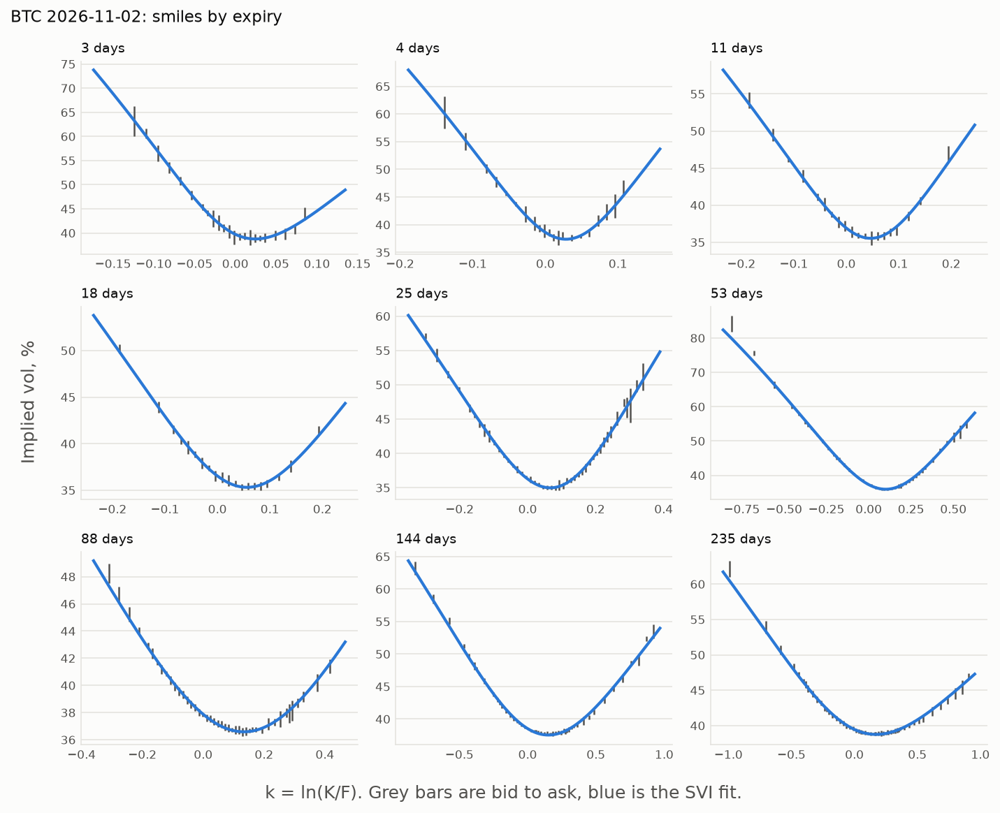
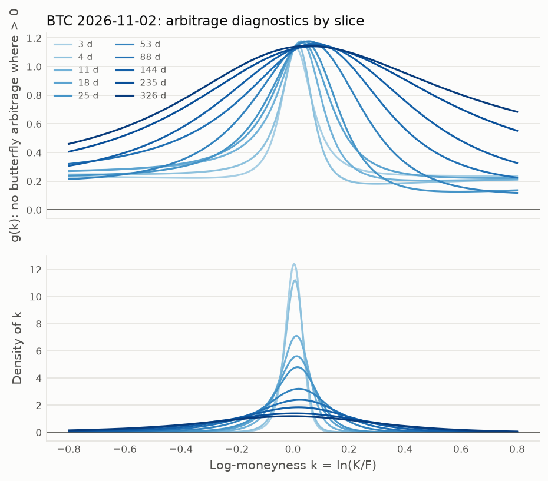

**Why not a cubic spline?** A natural cubic spline in implied vol, run through the same gate, has at least one butterfly or calendar violation on every one of the 78 days for both coins: 558 butterfly violations for BTC and 501 for ETH, against 0 for the exported SVI surfaces (`results/metrics/spline_baseline_<u>.json`, AC-H-06). Its implied density goes negative in the wings.

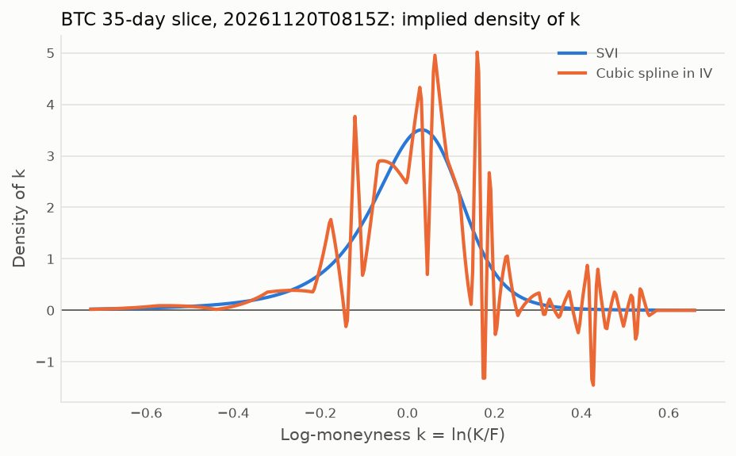

**What does skew tell you about the density?** Steeper put skew goes with more negative skewness of the risk-neutral density of ln(S_T/F). Across all slices of all days, the 25-delta risk reversal and the density's skewness have a correlation of 0.39 (BTC) and 0.56 (ETH) (`results/tables/rnd_skew_<u>.csv`).

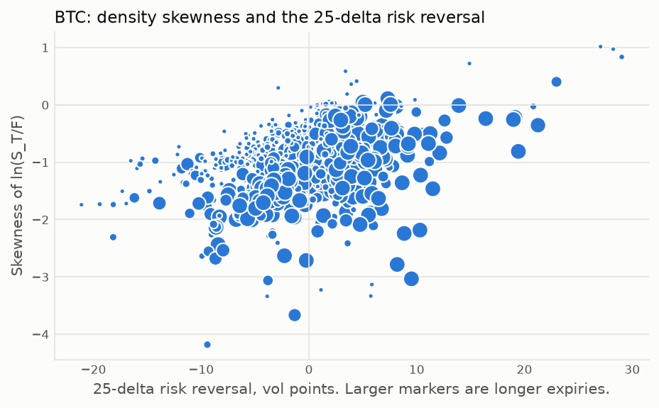

### Stability

SSVI parameters are already stable day to day without any penalty. Over the 15 recorder days, the 95th percentile of the daily change in rho is 0.041 (BTC) and 0.028 (ETH), against AC-H-01's 0.10, and of the relative change in eta 5.7% and 3.8%, against 20% (`results/metrics/stability_regularized_<u>.json`).

The penalty does not help. Holdout error was lowest at lambda = 1e-5, at 50.64 bp summed over both coins against 50.66 at lambda = 0, and rose steadily for larger lambda: 59.4 bp at 1e-2 and 67.2 bp at 1e-1 (`results/metrics/stability_lambda.json`). At the frozen 1e-5 the median daily change of the SVI-JW parameters moves by at most 6% either way, far from the 50% cut AC-H-01 asks for. **AC-H-01 is not met**: that cut fails, and there are 15 recorder days against the 30 required.

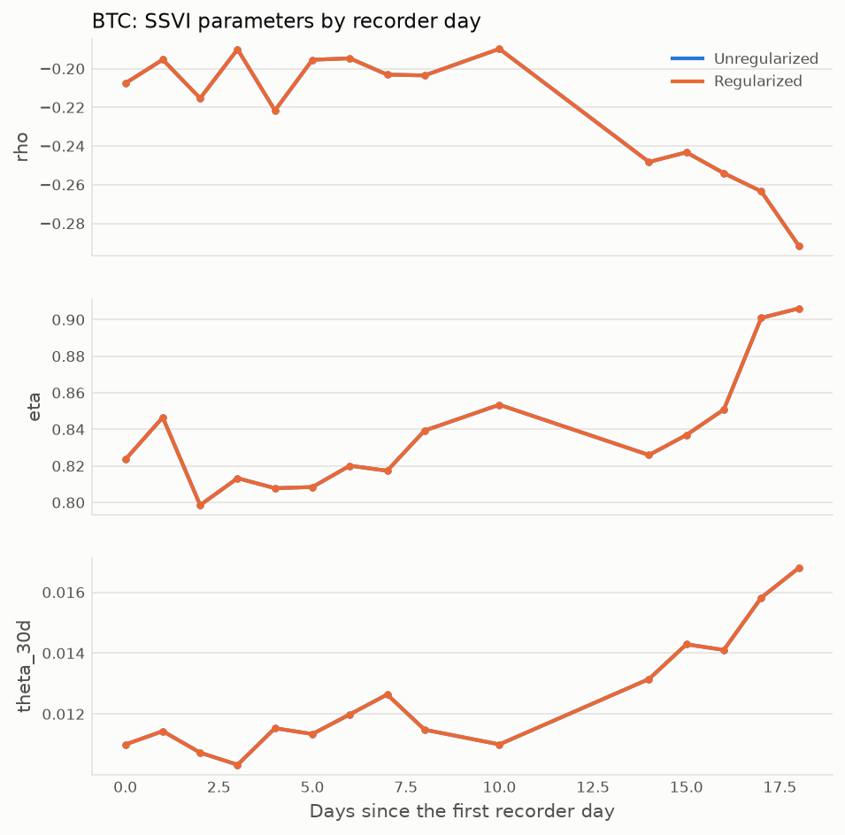

### Model comparison (AC-W-11)

| Model, 78 days | BTC IV RMSE | BTC inside spread | ETH IV RMSE | ETH inside spread |
|---|---|---|---|---|
| SVI slices | 45 bp | 94.7% | 52 bp | 95.8% |
| SABR, beta 1 | 60 bp | 88.4% | 65 bp | 92.3% |
| SSVI | 195 bp | 51.1% | 221 bp | 55.9% |
| Heston | 229 bp | 43.2% | 290 bp | 41.3% |

Source: `results/tables/model_comparison_<u>.csv`. Heston calibrates in a median 0.062 s (BTC) and 0.067 s (ETH) over 71 days, with the analytic Jacobian and a median 13 and 16 evaluations (`results/bench/heston_calib.json`, AC-H-04). It is fast but it cannot fit short-dated crypto smiles.

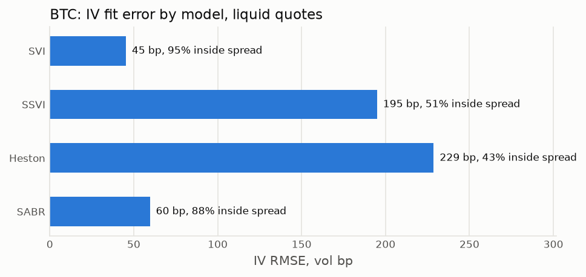

### Local vol and barriers (AC-H-03)

The Dupire grid is finite and positive on both dates and both coins, between 27% and 329%. Local vol Monte Carlo reprices 15 SSVI vanillas (5 strikes by 3 tenors) within 1.89 to 2.34 standard errors, against a limit of 3 (`results/metrics/localvol_<u>.json`).

30-day knock-out calls struck at the forward, 200,000 paths, prices in USD per coin with standard errors (`results/tables/barrier_lv_vs_heston_<u>.csv`):

| | Local vol | Heston | Flat Black | Heston fit RMSE |
|---|---|---|---|---|
| BTC 2026-10-01, down-and-out, barrier 0.85 F | 3,199 (10) | 3,153 (10) | 3,216 (9) | 92 bp |
| BTC 2026-10-01, up-and-out, barrier 1.20 F | 2,012 (6) | 2,076 (6) | 2,318 (6) | 92 bp |
| BTC 2026-11-02, down-and-out | 3,243 (9) | 3,197 (10) | 3,265 (9) | 115 bp |
| BTC 2026-11-02, up-and-out | 2,072 (6) | 2,179 (6) | 2,103 (6) | 115 bp |
| ETH 2026-10-01, down-and-out | 142.4 (0.5) | 134.8 (0.5) | 144.1 (0.4) | 117 bp |
| ETH 2026-10-01, up-and-out | 54.7 (0.2) | 60.0 (0.2) | 57.3 (0.2) | 117 bp |
| ETH 2026-11-02, down-and-out | 127.6 (0.4) | 122.3 (0.4) | 129.6 (0.4) | 226 bp |
| ETH 2026-11-02, up-and-out | 47.6 (0.2) | 55.1 (0.2) | 45.6 (0.2) | 226 bp |

**Why they differ.** Local vol reprices every vanilla of its surface, so its gap to Heston is about dynamics, not fit. With today's skew baked into a deterministic function of spot and time, local vol's forward smile flattens as time passes. Heston keeps a stochastic vol, which carries the skew forward and makes paths that wander far and come back more likely. That matters most to knock-outs. The up-and-out call, which loses its value on a rally, is worth more under Heston on all four dates: Heston's rallies come with falling vol. The down-and-out call is worth less under Heston on all four, because a sell-off comes with rising vol and is likelier to reach the barrier. Heston's fit errors of 92 to 226 bp mean part of the gap is also its misfit, which is why the table shows them.

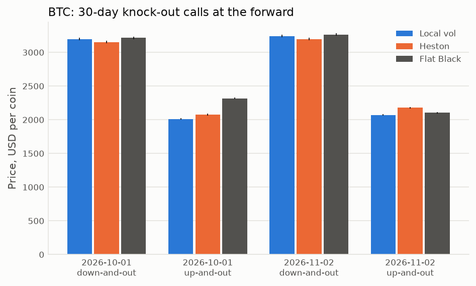
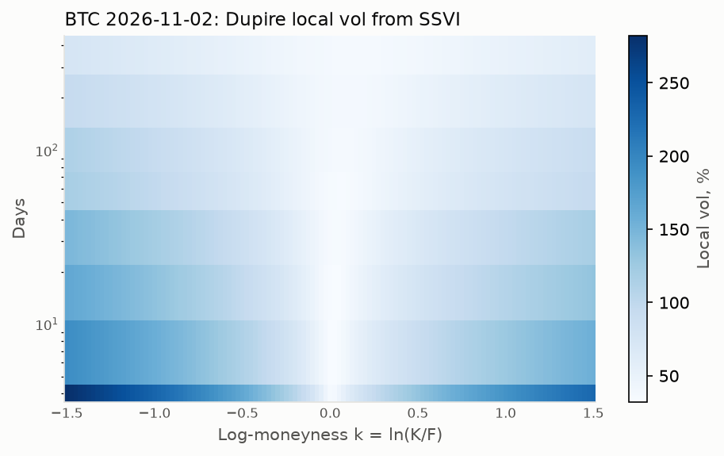

### Variance risk premium and straddles (AC-H-02)

**Implied against realized variance, 30 days** (`results/metrics/vrp_<source>_<u>.json`):

| | BTC | ETH |
|---|---|---|
| DVOL² minus realized, daily since 2021-04, Newey-West t (29 lags) | 0.076 (t 3.35) | 0.047 (t 1.12) |
| Same, share of days positive | 73% | 65% |
| Surface variance-swap rate minus realized, 62 months, t | 0.070 (t 1.25) | 0.029 (t 0.40) |

Implied variance does exceed realized variance on average, clearly for BTC on the long DVOL series, and it has been shrinking: BTC's yearly mean fell from 0.19 in 2021 to 0.02 in 2025.

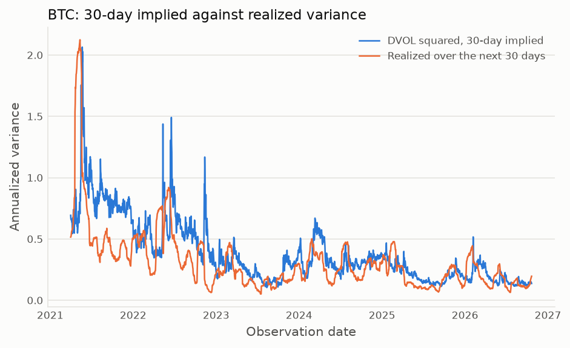

**Delta-hedged short straddles, one per month,** as a share of the forward, with 95% stationary-bootstrap intervals (`results/metrics/straddle_tardis_monthly_entry_iv_<u>.json`, `results/tables/straddles_tardis_monthly_entry_iv_<u>.csv`):

| | BTC | ETH |
|---|---|---|
| Entries (AC-H-02 needs 60) | 62 | 60 |
| Gross P&L, mean [95% CI] | +0.55% [-0.37, 1.39] | -0.13% [-1.33, 1.06] |
| Net of fills, fees, slippage and funding | **+0.02% [-0.90, 0.85]** | **-0.73% [-1.94, 0.46]** |
| Newey-West t, net | 0.05 | -1.19 |
| Gamma P&L R² (needs 0.8) | 0.86 | 0.96 |

**The premium is not recovered after costs.** BTC's net point estimate is positive but tiny, and both intervals include zero. Costs take 0.52% (BTC) and 0.59% (ETH) of the forward per trade, roughly all of BTC's gross premium. The largest part is the daily hedge's taker fee and slippage, 0.27%. Then come the option bid-ask spread, 0.18% and 0.25%, and option and delivery fees, 0.08% (per-trade columns in the straddles table). The hedged P&L tracks its theoretical gamma P&L closely, so the machinery works (AC-W-10 on synthetic data). It is the premium that is small.

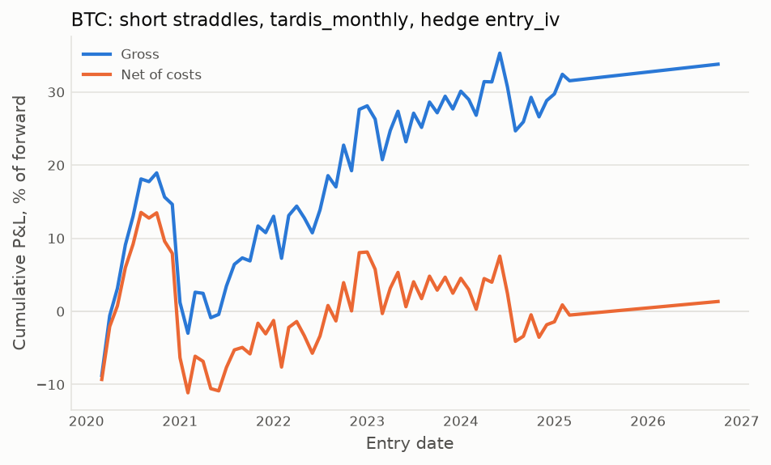
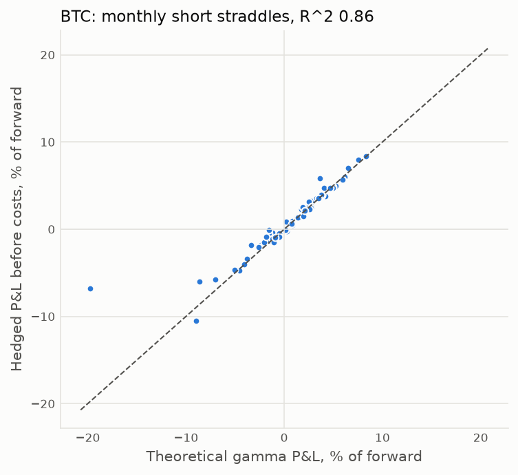

### Sticky strike or sticky delta (AC-H-07)

Over 12 pairs of consecutive recorder days, the 30-day IV change against the forward's log return (`results/metrics/sticky_<u>.json`):

| | BTC | ETH |
|---|---|---|
| Fixed strike, slope | -0.16 | -0.20 |
| Fixed moneyness, slope | -0.40 | -0.33 |
| 30-day skew dσ/dk | -0.32 | -0.22 |
| Conclusion | neither | sticky strike |

ETH behaves as sticky strike. For BTC the fixed-moneyness slope is close to its skew, as under sticky strike, but fixed-strike vols also fall as spot rises, so vol and spot move against each other beyond what the skew explains. **The project assumes sticky strike** for hedging, which ETH supports and BTC mostly does. The minimum-variance delta, which tries to capture the extra spot-vol move, hedged the straddles worse, not better: hedge-error variance 3.6e-4 against 3.0e-4 for BTC, 2.4e-4 against 1.2e-4 for ETH. Twelve pairs from November 2026 is a small sample.

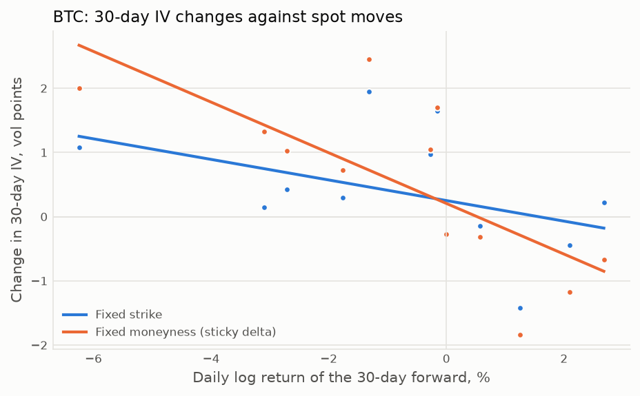

### Viewer (AC-H-05)

`reports/viewer/surface_BTC.html` and `surface_ETH.html` are static, self-contained 3D viewers of every exported day, with a date slider, (K, T, IV) on hover, and quote mids on five showcase dates.

## What failed

- **Heston on short-dated crypto smiles.** Its IV RMSE is 229 bp (BTC) and 290 bp (ETH), with fewer than half the liquid quotes inside the spread, against 45 to 52 bp for SVI. Leaving out expiries under 7 days cuts it to 170 and 227 bp, still more than three times SVI's error (`results/tables/heston_variants_<u>.csv`).
- **SSVI as a fit.** It fits about half the quotes inside the spread. It earns its place as the wing anchor and calendar-free backbone, not as the surface.
- **The stability penalty.** It brought no gain: the unregularized SSVI is already stable, and penalizing day-to-day changes in the SVI slices only made holdout error worse.
- **The VRP after costs.** It is not significant for either coin, and negative in point estimate for ETH.
- **The minimum-variance delta.** It hedged worse than Black-Scholes delta.
- **Recorder coverage.** Two host crashes put AC-W-04 out of reach for the canonical-day share.
- **Corrections along the way** are logged in `docs/decisions.md`: an IV solver bracket bug, a gate that only checked quoted endpoints, a local vol interpolation error caught by the repricing test, and a gamma R² defined first with its slope fixed at 1.

## Limitations

- **Sample length.** 62 monthly entries are few for a premium the size of the costs, and the monthly sample skips 2025-04 to 2026-09. The daily recorder history is three weeks.
- **Inverse contracts.** The perpetual hedge is treated as linear in USD, which is exact only if its coin P&L is converted as it accrues. The premium is sold forward at the expiry's forward, and the coin rate is zero (D-04).
- **Daily hedging** at 08:15 UTC, at the last perpetual close known by then. Funding is at Deribit's 1-hour rate.
- **Fee assumptions.** Standard-tier taker fees for every leg, from archived fee pages by period. A market maker would pay much less, so these costs are an upper bound for a taker.
- **One venue, two coins, no SPX** (D-03).

## How to reproduce

```bash
uv sync
uv run vsm smoke
uv run vsm build --underlying BTC --start 2026-11-02 --end 2026-11-20
uv run vsm calibrate --model heston --underlying BTC --start 2026-11-02 --end 2026-11-20
uv run vsm straddle --underlying BTC --source tardis_monthly
uv run vsm reproduce --skip-ingest
```

`vsm reproduce --skip-ingest` rebuilds every result, table, figure and the viewer from the local store. Two runs give byte-identical files under `results/`, apart from `experiment_log.csv` and `bench/` (AC-W-08). `data/` lives under `$DATA_ROOT`, outside the repo.

**Trial count.** `results/experiment_log.csv` has 198 runs. The straddle study has one design with four variants (three hedges on monthly entries, plus daily recorder entries), run 40 times as data arrived. One metric definition, the gamma R², changed after the first run, and both values are reported.

## What is not done

- **AC-H-01** needs 30 recorder days; there are 15. It also fails on the 50% cut, as above.
- **Timing benchmarks** for build time per day and Monte Carlo time wait until after 2026-12-18, while other multi-week runs share this PC. `results/bench/` holds IV throughput (47 million vols per second, i9-14900K) and Heston times.
- **AC-W-04** is a documented miss (see Data).

## Requirements

- [x] Quote cleaning: drop zero bids and wide markets; use mid or bid/ask-weighted implied vol. (FR-07, FR-10)
- [x] Implied forward and dividend or borrow from put–call parity for each expiry. (FR-08)
- [x] A robust implied-vol solver (Jäckel’s ‘Let’s Be Rational’ or a safeguarded Newton/Brent). (FR-09)
- [x] Raw SVI per expiry plus a global SSVI fit (Gatheral and Jacquier 2014), with butterfly and calendar no-arbitrage enforced. (FR-11, FR-12)
- [x] Arbitrage diagnostics: Durrleman’s g(k) ≥ 0, non-decreasing total variance, positive Breeden–Litzenberger density. (FR-13)
- [x] Model calibration: Heston via COS or Carr–Madan FFT, and SABR (Hagan) per expiry; compare fit error and stability. (FR-15 to FR-18)
- [x] A variance risk premium study: implied vs realized variance, and delta-hedged option P&L. (FR-21, FR-22)

## Success criteria

### Works (correct and reproducible)

- [x] The IV solver round-trips price → vol → price to 1e-10 across moneyness, deep wings included. (AC-W-01, as amended by the owner for ITM points)
- [x] Zero static-arbitrage violations in fitted surfaces, checked automatically for every day. (AC-W-02, 78 days per coin)
- [x] Fit error falls inside the bid–ask spread for over 90% of liquid quotes. (AC-W-03)
- [ ] The recorder accumulates history. (AC-W-04, a documented miss: 75% of canonical days against 90%)
- [x] Cleaning and forwards are correct and point-in-time. (AC-W-05)
- [x] Pricers and diagnostics validated against known results. (AC-W-06)
- [x] Heston analytic gradients are correct. (AC-W-07)
- [x] Reproducible and clean. (AC-W-08)
- [x] Export is valid and round-trips. (AC-W-09)
- [x] VRP and straddle machinery is unbiased on synthetic data. (AC-W-10)
- [x] Model comparison delivered. (AC-W-11)

### Impresses hirers

- [ ] A daily surface history with stable parameters (no jumping SVI parameters from one day to the next). (AC-H-01: SSVI stable, but 15 of 30 days and the regularization test fails)
- [x] A delta-hedged straddle study that recovers the variance risk premium after costs. (AC-H-02: delivered; the premium is not recovered, and the memo says so)
- [x] Dupire local vol extracted from the surface and used to price a barrier option, compared with Heston. (AC-H-03)
- [x] Fast calibration (Heston in under a second with analytic gradients) and an interactive 3D surface viewer. (AC-H-04, AC-H-05)
- [x] Spline against SVI and the risk-neutral density. (AC-H-06)
- [x] An evidence-based sticky-strike or sticky-delta answer. (AC-H-07)
- [x] This research memo. (AC-H-08)

## Questions this project must answer

- **Why not just interpolate IV with a cubic spline?** Because it breaks static arbitrage on every day, with a negative density in the wings ([Results](#fit-quality-and-arbitrage)).
- **What does skew tell you about the risk-neutral density?** Steeper put skew means more negative density skewness ([Results](#fit-quality-and-arbitrage)).
- **Sticky strike or sticky delta: which did you assume, and why?** Sticky strike, which ETH supports and BTC mostly does ([Results](#sticky-strike-or-sticky-delta-ac-h-07)).

MIT licence, code only. Deribit market data is Deribit's; Tardis.dev files are used under their free first-of-month terms.
